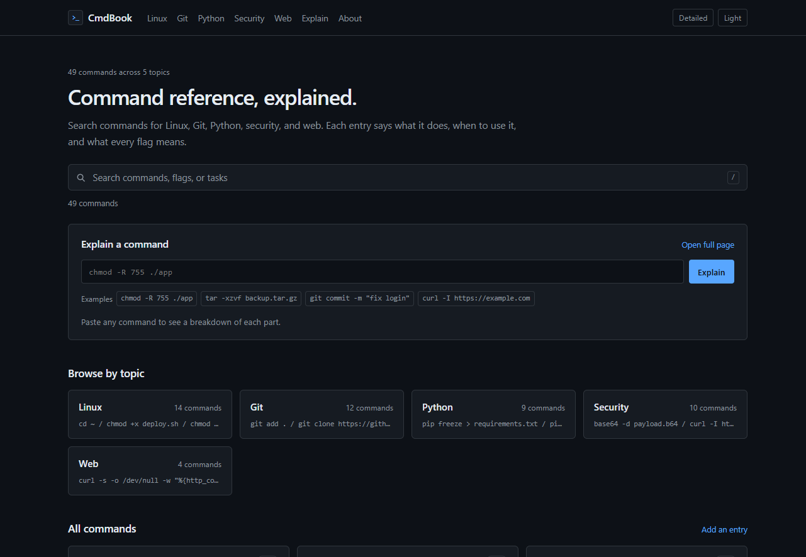

# CmdBook

A command reference for Linux, Git, Python, security, and web. Every entry explains what the command does, when to use it, and what each flag means. A built-in explainer breaks down any command you paste.



## Pages

| Page | Contents |
| --- | --- |
| `index.html` | Search across all entries, the explainer, and a topic index |
| `linux.html` | Files, permissions, processes, archives, and remote shells |
| `git.html` | Cloning, committing, branching, syncing, and undoing mistakes |
| `python.html` | Environments, packages, scripts, tests, and small utilities |
| `security.html` | Keys, hashes, TLS, DNS, and checks to run before publishing |
| `web.html` | Local servers, HTTP requests, and JSON APIs |
| `explain.html` | Full-page command explainer |
| `about.html` | Entry format and contributing instructions |

## Run locally

Open `index.html` directly, or serve the folder:

```bash
python -m http.server 8000
```

Then open `http://localhost:8000`. The data is bundled into `data/bundle.js` as a plain script, so there is no build step and no runtime dependency.

## How the explainer works

The input is split on whitespace (respecting quotes) and then on unquoted pipes. The first token of each segment is looked up as a program, and the remaining tokens are classified as flags, arguments, URLs, paths, or permission modes.

- Programs and flags are defined in `data/commands.json`.
- Combined short flags such as `-xzvf` are expanded when every letter is known.
- Numeric modes passed to `chmod` are decoded into owner, group, and other permissions.
- Destructive patterns such as `rm -rf /`, `curl | sh`, and `git reset --hard` trigger a warning.

Unknown programs and flags are labelled as unknown rather than guessed.

## Adding an entry

1. Add the entry to the matching file in `data/`.
2. If the explainer should understand the program, add it to `data/commands.json`.
3. Rebuild the bundle and validate:

```bash
python scripts/build_bundle.py
```

The script checks required fields, duplicate IDs, broken `related` links, and the shape of the flag dictionary. CI runs the same check with `--check`.

### Entry fields

```json
{
  "id": "tar-extract",
  "command": "tar -xzvf backup.tar.gz",
  "plain": "Extract a .tar.gz archive into the current folder.",
  "when": "You downloaded a .tar.gz and need the files inside.",
  "safety": "safe",
  "tags": ["files", "archives"],
  "flags": [
    { "flag": "-x", "meaning": "extract" },
    { "flag": "-z", "meaning": "decompress gzip" }
  ],
  "related": ["find-name"]
}
```

`id`, `command`, `plain`, `when`, `safety`, and `tags` are required. `safety` is `safe`, `caution`, or `danger`. Every ID in `related` must exist. Use `plain` for what the command does and `when` for the situation that makes you reach for it.

## Project structure

```
cmdbook/
├── index.html
├── linux.html
├── git.html
├── python.html
├── security.html
├── web.html
├── explain.html
├── about.html
├── 404.html
├── styles.css
├── app.js
├── sw.js
├── manifest.webmanifest
├── icon.svg
├── data/
│   ├── linux.json
│   ├── git.json
│   ├── python.json
│   ├── security.json
│   ├── web.json
│   ├── commands.json
│   └── bundle.js          generated
├── scripts/
│   └── build_bundle.py
└── .github/workflows/
    └── validate.yml
```

## Deployment

The site is static and has no build step. On GitHub:

1. Open **Settings → Pages**.
2. Set **Source** to **Deploy from a branch**.
3. Choose `main` and `/ (root)`.

Commit the regenerated `data/bundle.js` whenever the data changes.

## License

MIT. See [LICENSE](LICENSE).
